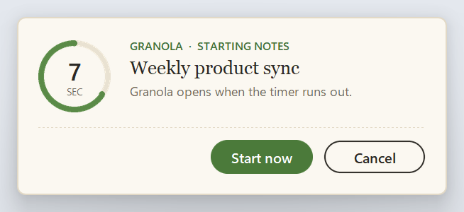
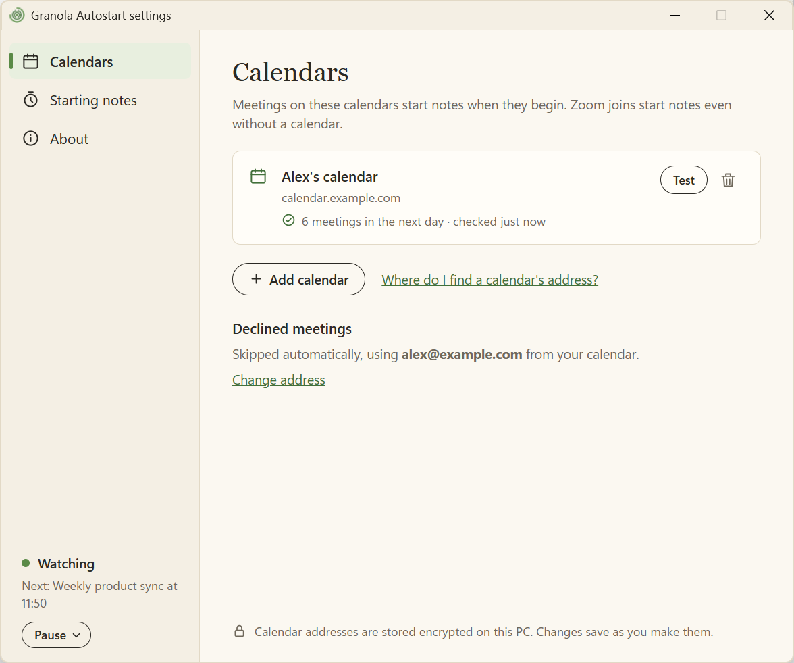

# Granola Autostart

> **Disclaimer:** this is a small personal project, to fix a frustration I have with missing meeting notes. It is 100% AI-built, on a best-effort basis, with no guarantee of success.

Starts [Granola](https://granola.ai) when a meeting begins on this PC. A small card appears first in the top-right corner of the screen under the pointer, with the meeting title and a 10-second ring.

**Cancel** leaves Granola alone. **Start now** or doing nothing opens that meeting's note and starts transcription. It does not join Zoom. The card never takes keyboard focus, so typing in another app is not interrupted (and Esc is not used). If the card itself can't open, notes for a meeting start anyway, as if nobody had answered it, and the tray says the card is broken. Notes aren't restarted after Granola closes without a card to cancel.

It runs in the background, so this still works when Granola was quit or crashed. The same card is used for a calendar meeting (including one where you are in the room and not on Zoom), a Zoom join, and Granola closing mid-meeting (for notes started from a Zoom call, while that call is still going).

Notes start only when the Windows session is unlocked and you have used the mouse or keyboard in the last few minutes. A locked or idle laptop does not start a recording. If you sit down after the start time, the card appears then, until the meeting's scheduled end.

Granola Autostart is an independent tool and is not made by Granola.





## Install

1. Get `GranolaAutostart-<version>-setup.exe` from the [releases](https://github.com/cfoucher/granola-autostart/releases), or from whoever shared it with you.
2. Run it. It installs for your Windows user only, with no admin rights, to `%LOCALAPPDATA%\Programs\Granola Autostart`. The installer isn't signed yet, so if Windows SmartScreen appears, choose **More info**, then **Run anyway**.
3. Setup opens. Zoom calls work straight away. For in-person and other meetings, connect a calendar:
   - **Google Calendar:** open [Calendar settings](https://calendar.google.com/calendar/r/settings), choose your calendar under **Settings for my calendars**, then **Integrate calendar**, and copy **Secret address in iCal format**. Google Workspace admins can turn secret addresses off; they work at Shift today.
   - **Outlook:** Settings, **Shared calendars**, **Publish a calendar**, choose **Can view all details**, then copy the **ICS** link.

   Paste it, choose **Test address**, check the meetings it found, then **Finish**.

It starts again whenever you sign in to Windows. Look for the green ring with a small labyrinth in the system tray; the dot in its middle is green while it's watching.

### Settings

Left-click the tray icon, or right-click it and choose **Settings…**.

- **Calendars:** add, test, and remove calendars. Each shows how many meetings it has in the next day, or why its downloads are failing. Secret addresses are encrypted for your Windows user (DPAPI) and never written to the log.
- **Declined meetings** are skipped. The address comes from your calendar (a Google calendar is named after its account); add another address for aliases or Outlook calendars.
- **Starting notes:** countdown length (with **Preview**), how recently you must have used the PC, and words that skip a meeting (`focus time`, `out of office`, and `lunch` to start with). All-day events are always skipped.
- **About:** version, whether it's running (with **Quit** or **Start**), the last time it started Granola, and the log folder.

The box at the foot of the side panel shows what the app is doing: starting up (or restarting after a problem), watching (and the next meeting), taking notes, paused, needing attention, or not running. It has the tray menu's buttons: **Pause** (for 1 hour or the rest of today), **Resume**, **Fix**, and **Start**.

Changes save as you make them, and the running app picks them up within a few seconds.

To start notes for only some meetings on another calendar, without blocking time on your main calendar, create a calendar such as "Granola watch" in your own account and add its secret address. Then put each meeting you care about on it: invite the calendar's address (`…@group.calendar.google.com`, under Integrate calendar) if you can edit the meeting, or create your own event there with the same title and time, marked Free. The same meeting on two calendars only prompts once.

Calendars are downloaded every 5 minutes while you are at the PC, and again when you come back. A meeting added a few minutes before it starts can take that long to appear.

### Tray and notifications

- **Pause for 1 hour** or **Pause for today** — no new cards, and a countdown already on screen will not start Granola. A Zoom join during the pause is not asked about later. The icon's middle dot turns grey.
- **Resume**, **Settings…**, **Open log folder**, **About**, **Quit** (it starts again at the next sign-in, or from the Start menu).

When something needs fixing, the middle dot turns orange and Windows shows a notification once:

- **Granola didn't open** 30 seconds after a start, or at once when Windows couldn't open its link. Granola's launch link is undocumented, so an update could break it; **Try again**, or open Granola yourself.
- **A calendar isn't updating** after 3 failed downloads in a row.
- **Settings couldn't be read**, after a hand edit broke `config.json`. Zoom joins still start notes meanwhile.
- **The countdown card couldn't open.** Meetings start notes without it, but Granola isn't restarted after it closes. The log folder says why.

Granola's own one-minute reminder is unchanged. Clicking that reminder still opens the video call. Turn it off in Granola's notification settings if the second popup is in the way.

### Uninstall

**Settings**, **Apps**, **Installed apps**, **Granola Autostart**, **Uninstall**. It stops the app and asks whether to keep your settings.

Files: `%LOCALAPPDATA%\granola-autostart` holds `config.json`, `state.json`, `status.json`, and the logs (`log.txt`, `supervisor-log.txt`, `settings-log.txt`, `cli-log.txt`, and `notice-log.txt` if the countdown card ever fails). Logs record meeting titles, never calendar addresses.

## Security

A secret calendar address works like a password: anyone who has it can read your whole calendar. Here is how the app handles it, and where that protection stops.

**What is protected.** Calendar addresses are encrypted in `config.json` with the Windows Data Protection API (DPAPI), through `CryptProtectData`. DPAPI means the app stores no key: Windows derives it from your sign-in. Microsoft describes DPAPI as [encrypting data with the current user's account, without you generating or storing a key](https://learn.microsoft.com/en-us/dotnet/standard/security/how-to-use-data-protection), and documents its behaviour and limits in the [`CryptProtectData` reference](https://learn.microsoft.com/en-us/windows/win32/api/dpapi/nf-dpapi-cryptprotectdata). Neither page says DPAPI is *the* recommended way to store a per-user app's secrets; it is the built-in Windows mechanism for this job, and a common choice for it.

Addresses never appear in the logs, `status.json` (feeds there are named by a hash) or error messages. Downloads must use HTTPS, are refused if redirected to plain HTTP, and are capped in size and time. A test (`test_a_failed_download_never_puts_the_address_in_the_log_or_status`) fails every kind of download error on purpose and checks the address appears nowhere.

**What this does not protect against:**

- **Other programs running as you.** DPAPI ties the data to your Windows account, so any program running under it can decrypt the address. The app also mixes in a fixed extra string, but it is in the source code, so it only stops programs that don't know it. It is not a second secret. Microsoft's pages don't cover this case, so don't read them as saying DPAPI defends against it.
- **Someone who knows your Windows password.** The key comes from your sign-in, so your account's security is the app's security. Use a strong password or Windows Hello, and turn on BitLocker so a stolen laptop's disk can't be read offline.
- **Another PC or account.** Copying `config.json` elsewhere doesn't work, by design. The app tells you to clear the `ics_urls_protected` list and add your calendars again.
- **Everything else in the folder.** Only the addresses are encrypted. `config.json` settings, `state.json`, `status.json` and the logs are plain text in `%LOCALAPPDATA%\granola-autostart`, and the logs record meeting titles.
- **A leaked address.** The app can't revoke it. If you think one has leaked, reset it at the source: in Google Calendar, **Integrate calendar**, **Reset** next to the secret address; in Outlook, unpublish the calendar and publish it again. Then paste the new address into Settings.

## Development

Use Python 3.13, as CI and the installer do:

```powershell
python -m venv .venv
.venv\Scripts\pip install -r requirements-build.txt -c constraints.txt
git config core.hooksPath .githooks   # the pre-push checks, below
.venv\Scripts\python -m pytest
```

Running from source, in the checkout folder:

```powershell
.venv\Scripts\python -m granola_autostart --check            # presence, Zoom, and calendar status
.venv\Scripts\python -m granola_autostart --preview-notice   # show the card once
.venv\Scripts\python -m granola_autostart --dry-run          # the real watcher, logging the Granola link instead of opening it
.venv\Scripts\python -m granola_autostart --settings         # Settings (--setup for first-run setup)
```

Only one watcher runs at a time, so stop an installed copy first (right-click the tray icon, **Quit**). `--install` and `--uninstall` set up a source checkout to start at sign-in, in the same startup entry the installer uses, so they replace and remove an installed copy's.

### Tests and coverage

Coverage may never fall. `coverage-floor.txt` holds the lowest total coverage allowed (statements and branches), and it only moves up:

```powershell
.venv\Scripts\python tools\coverage_ratchet.py            # the tests under coverage, held to the floor
.venv\Scripts\python tools\coverage_ratchet.py --update   # raise the floor after adding tests
```

The pre-push hook refuses a push to `main` and checks every commit being pushed, as committed: ruff, the tests, and the floor. When coverage rose, it writes the new floor to `coverage-floor.txt` and stops the push, so that the raised floor is committed too. `git push --no-verify` skips the hook, but pull requests run the same checks, and a ruleset on `main` won't merge one until both pass:

- **checks**: `ruff check` (errors such as undefined names and unused imports, not style), the tests and the floor (a rise must raise the floor here too), and diff coverage: the tests must run at least 80% of the lines a pull request adds or changes in `granola_autostart/`. To see that before pushing, run `.venv\Scripts\python -m coverage xml`, then `.venv\Scripts\diff-cover coverage.xml --compare-branch=origin/main`.
- **installer**: builds the installer.

### Layout

- `granola_autostart/` is the app, one package. `__main__.py` starts every mode, from source and in the packaged exe.
  - `watcher.py`: the meeting checks each tick, the tray, and the command line.
  - `decide.py`: when to show the countdown, as pure logic. `state_store.py` remembers what was cancelled or started.
  - `calendar_feed.py` reads a calendar, and `calendar_cache.py` keeps them all downloaded. `zoom_meetings.py` and `presence.py`: Zoom, and whether you are at the PC.
  - `granola_launch.py`: opens the meeting's note in Granola.
  - `notice.py`: the countdown card. `settings_app.py`: Settings and setup, a WebView2 window showing the page in `web/`.
  - `processes.py`: starting each mode, one of each at a time, the sign-in entry, and the supervisor that restarts the watcher.
  - `status.py`, `notify.py`, `icon.py`, `winui.py`, `commands.py`: what the tray and Settings show, notifications, the icon, the Windows theme and window colours, and Settings' Pause, Resume, and Quit.
  - `settings.py`, `secret_box.py`: config, file paths and writes, and the encryption for calendar addresses.
- `tests/`: pytest.
- `tools/`: the coverage ratchet and the pre-push checks, which `.githooks/pre-push` runs. `coverage-floor.txt` is the ratchet's floor.
- `packaging/`: the PyInstaller spec and its entry script (`entry.py`), the Inno Setup script, and the icon drawing for both. `build.ps1` runs them.
- `constraints.txt`: the exact package versions builds use; Dependabot (`.github/dependabot.yml`) opens weekly pull requests to bump them, and its header says how to refresh them by hand.

### Building the installer

With the build requirements and Inno Setup 7 (6 also works) installed:

```powershell
.\build.ps1
```

It runs the tests under the coverage ratchet, builds `dist\GranolaAutostart\` with PyInstaller, then `dist\GranolaAutostart-<version>-setup.exe`. One `GranolaAutostart.exe` runs every mode: the watcher, `--supervise`, `--notice`, `--settings`, `--setup`, and `--stop`.

GitHub Actions runs the checks and builds the installer for pull requests, pushes to `main`, and version tags, keeping the installer for 7 days. A push to `main` that changes only Markdown files doesn't start a build; a pull request always does. A tag such as `v1.0.0` must match `__version__` in `granola_autostart/__init__.py`, and also creates a GitHub release with the installer attached.

Dependabot opens pull requests each week for newer Python packages and GitHub Actions. The Dependabot workflow merges a Python update that isn't a major version once its checks pass, and then runs the Release workflow with a patch bump, unless `main` also has unreleased changes of your own. GitHub Actions updates and major versions wait for you to merge them.
