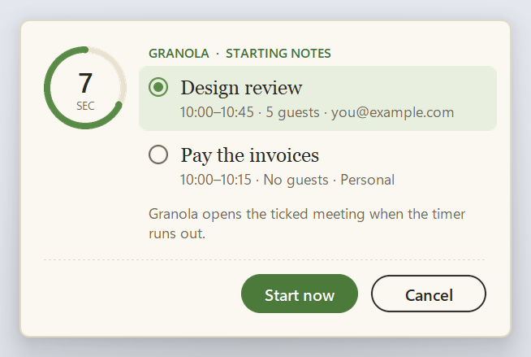
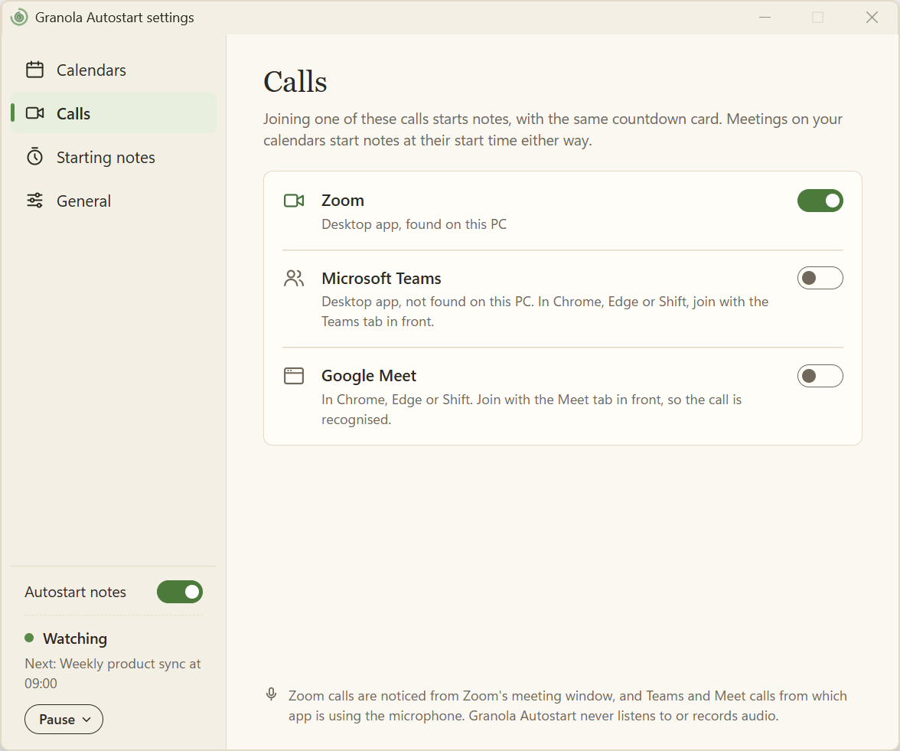

# Granola Autostart

> **Disclaimer:** this is a small personal project, to fix a frustration I have with missing meeting notes. It is 100% AI-built, on a best-effort basis, with no guarantee of success.

Starts [Granola](https://granola.ai) when a meeting begins on this PC, or when you join a Zoom call. Microsoft Teams and Google Meet calls work too, once you switch them on: they're off by default. A small card appears first in the top-right corner of your main display (below Granola's own meeting popup, when that's showing there), with the meeting title and a 10-second ring. For a calendar meeting it appears that long before the start, so notes start as the meeting begins. If the card is in the way, drag it by its background to move it. The countdown carries on.

**Cancel** leaves Granola alone. **Start now** or doing nothing opens that meeting's note and starts transcription. It does not join the call. The card never takes keyboard focus, so typing in another app is not interrupted (and Esc is not used). If the card itself can't open, notes for a meeting start anyway, as if nobody had answered it, and the tray says the card is broken. Notes aren't restarted after Granola closes without a card to cancel.

It runs in the background, so this still works when Granola was quit or crashed. The same card is used for a calendar meeting (including one where you are in the room and not on a call), a call you join, and Granola closing mid-meeting (for notes started from a call, while that call is still going).

When several meetings start together, the card lists them, up to four, and you tick the one to take notes for. One with guests is ticked first, then the one on the calendar higher in your list, then the later start. Its notes answer the others, and **Cancel** answers them all. A call you join while several meetings are under way lists them the same way.



A meeting that runs long keeps its notes: while you're still in its call, the next meeting's card waits until you leave that call. Joining the next meeting's call brings its card straight away. Back-to-back meetings on one Zoom link, such as a personal room, share the first one's notes.

Notes start only when the Windows session is unlocked and you have used the mouse or keyboard in the last few minutes. A locked or idle laptop does not start a recording. If you sit down after the start time, the card appears then, until the meeting's scheduled end.

Granola Autostart is an independent tool and is not made by Granola.




## Install

1. Get `GranolaAutostart-<version>-setup.exe` from the [releases](https://github.com/cfoucher/granola-autostart/releases).
2. Run it. It installs for your Windows user only, with no admin rights, to `%LOCALAPPDATA%\Programs\Granola Autostart`. The installer isn't signed yet, so if Windows SmartScreen appears, choose **More info**, then **Run anyway**.
3. Setup opens. Choose **Get started**, then on **Calls** choose which calls start notes. Zoom is on, and Teams and Meet are off until you switch them on. **Calls only for now** finishes setup there. For in-person and other meetings, choose **Connect a calendar**:
   - **Google Calendar:** open [Calendar settings](https://calendar.google.com/calendar/r/settings), choose your calendar under **Settings for my calendars**, then **Integrate calendar**, and copy **Secret address in iCal format**. Google Workspace admins can turn secret addresses off; they work at Shift today.
   - **Outlook:** Settings, **Shared calendars**, **Publish a calendar**, choose **Can view all details**, then copy the **ICS** link.

   Paste it, choose **Test address**, check the meetings it found, then **Finish**. Setup also says whose declined meetings are skipped, with **Add another address** for an alias.

It starts again whenever you sign in to Windows, unless you turn that off in **General**. Look for the green ring with a spiral inside it in the system tray; the spiral is green while it's watching.

### Settings

Left-click the tray icon, or right-click it and choose **Settings…**. The side panel has **Calendars**, **Calls**, **Starting notes**, and **General**.

- **Calendars:** add, test, and remove calendars. **Add calendar** is at the top of the page, and the arrow at the end of a row opens its settings: **Skip meetings declined by**, **Test**, and **Remove calendar**. Each calendar shows how many meetings it has in the next day, or why its downloads are failing. Calendars stay in your order: the up and down arrows on a row move it, and the order decides which meeting the card ticks first when several start together. With five or more, the list scrolls under a header that counts them. Secret addresses are encrypted for your Windows user (DPAPI) and never written to the log.
  - Each calendar has a switch. Off, it isn't downloaded, its meetings don't start notes, and it never raises "isn't updating". It still lends its address to the other calendars' declines, so switching off your main calendar doesn't change what the others skip.
  - **Skip meetings declined by** lists the addresses whose declined meetings are skipped, one list per calendar. Automatic reads the calendar's own address (a Google calendar is named after its account). A calendar that names no address, such as an Outlook one or a calendar you made yourself, uses your other calendars' addresses. To add an alias, put it in the list: the calendar then skips meetings declined by exactly the addresses listed. With every address removed, declines aren't checked on that calendar, so every meeting on it starts notes. **Reset addresses** goes back to automatic.
- **Calls:** a switch for each of Zoom, Microsoft Teams, and Google Meet. Zoom is on. Teams and Meet are off until you switch them on, even when Teams is installed. Zoom and Teams say whether their app was found on this PC (Zoom under your user folder or in Program Files); that is only a hint, and doesn't decide whether a call is noticed. Only a call that has just begun gets a card, so one already under way when you switch its provider on isn't asked about. When no meeting on your calendars matches the call, the card and the notes use the meeting's name from its window when it shows one (Teams and Meet often do; Zoom doesn't), or otherwise the app and when the call began, such as "Zoom call at 3:57 PM", "Teams call at 3:57 PM", or "Google Meet call at 3:57 PM".
  - **Zoom** is noticed while a meeting is open in the desktop app. Zoom in a browser isn't noticed.
  - **Teams** is noticed while the new Teams app holds the microphone, which it does for the whole call, muted or not. Any use of the microphone in Teams counts, so a test call from its device settings can bring up a card too. In Chrome, Edge or Shift, a Teams call is noticed the way Meet is: while the browser holds the microphone and a Teams tab was in front when that began. **Join with the Teams tab in front.** Switching tabs afterwards doesn't end the call. Any use of the microphone in that browser with a Teams tab in front counts.
  - **Meet**, in Chrome, Edge or Shift, is noticed while the browser holds the microphone and a Meet tab was in front when that began. **Join with the Meet tab in front.** Switching tabs afterwards doesn't end the call. If Meet and Teams tabs are both in front, it counts as a Meet call.
  - Teams and Meet rely on a Windows record of which app is using the microphone. Windows doesn't document it, so an update could break it. Only that record is read, never any audio. A Teams or Meet call with no microphone (none connected, or Windows blocking the app from it) isn't noticed. Zoom depends on neither.
- **Starting notes:** countdown length (with **Preview**), how recently you must have used the PC, and words that skip a meeting or a call (`focus time`, `out of office`, and `lunch` to start with). A call during a meeting follows that meeting, so it is skipped when the meeting is. A call that matches no meeting on your calendars is skipped when its own name has one of the words. All-day events are always skipped.
- **General:** **Start when you sign in to Windows**, **Appearance** (**Auto**, **Light**, or **Dark**, for Settings, setup, the countdown card, and the tray menu; Auto follows Windows), the version with **Check now** and **Install update** (see Updates), the last time it started Granola, the log folder, **Quit**, and **Run setup again**. The tray's **About** opens this page.
  - The switch is in the installed app only; from a source checkout, `--install` does it. It only puts the app in the tray at sign-in, and whether it starts notes is the **Autostart notes** switch.
  - The switch also shows off when Windows' Startup apps setting, or Task Manager's Startup tab, has turned the app off, and switching it on here turns it back on there.

The box at the foot of the side panel shows what the app is doing: starting up (or restarting after a problem), watching (and the next meeting), taking notes, paused, off, needing attention, or not running. Its **Autostart notes** switch is the app's on and off, the same as the tray's **Turn off** and **Turn on**. It has the tray menu's other buttons: **Pause** (for 1 hour or the rest of today), **Resume**, **Fix**, and **Start**. While it's off there are none, as long as the app is running (if it isn't, the box says Not running and shows **Start**): switch it back on.

Changes save as you make them, and the running app picks them up within a few seconds.

To start notes for only some meetings on another calendar, without blocking time on your main calendar, create a calendar such as "Granola watch" in your own account and add its secret address. Then put each meeting you care about on it: invite the calendar's address (`…@group.calendar.google.com`, under Integrate calendar) if you can edit the meeting, or create your own event there with the same title and time, marked Free. The same meeting on two calendars only prompts once, and is skipped only if every calendar it's on skips it as declined. The watch calendar names no address of its own, so it uses your other calendars' addresses, and a meeting you declined is declined on it too. Remove its addresses under **Skip meetings declined by** and every meeting on it starts notes, even ones you declined.

Calendars are downloaded every 5 minutes while you are at the PC, and again when you come back. A meeting added a few minutes before it starts can take that long to appear.

### Tray and notifications

- **Pause for 1 hour** or **Pause for today** — no new cards, and a countdown already on screen will not start Granola. A call joined during the pause is not asked about later. The icon's spiral turns grey.
- **Turn off** — nothing starts notes until you choose **Turn on**. The whole icon turns grey, and the first line reads "Off. Meetings and calls won't start notes".
- **Install update…** — shown at the top while an update is ready, with a small blue badge on the icon. It waits while a countdown card is on screen.
- **Resume**, **Settings…**, **Open log folder**, **About**, **Quit** (it starts again from the Start menu, or at sign-in if that switch is on).

**Turn off, Pause, or Quit?** They last for different times:

- **Turn off** lasts until you turn it on again, through restarts and sign-ins. Use the tray's **Turn off**, or the **Autostart notes** switch in Settings. While it's off, no cards appear, no calendars are downloaded, no calls are checked, and Granola isn't restarted after it closes. A countdown already on screen won't start Granola, and notes already running carry on. A call you joined meanwhile isn't asked about when you turn it back on, which downloads your calendars at once and gives a meeting under way its card. The daily update check goes on.
- **Pause** runs out by itself, after 1 hour or at midnight, and a restart doesn't cancel it. Calendars are still downloaded meanwhile.
- **Quit** stops the app until you next sign in to Windows or open it from the Start menu. With **Start when you sign in to Windows** off, that is until you open it yourself.

When something needs fixing, the spiral turns orange and Windows shows a notification once:

- **Granola didn't open** 30 seconds after a start, or at once when Windows couldn't open its link. Granola's launch link is undocumented, so an update could break it; **Try again**, or open Granola yourself.
- **A calendar isn't updating** after 3 failed downloads in a row.
- **Settings couldn't be read**, after a hand edit broke `config.json`. Until it's fixed the app keeps the last settings it could read, or the defaults if it started with that file (Zoom calls only, and no calendars, as Teams and Meet are off until it can read your choices).
- **The countdown card couldn't open.** Meetings start notes without it, but Granola isn't restarted after it closes. The log folder says why.

Granola's own one-minute reminder is unchanged. Clicking that reminder still opens the video call. Turn it off in Granola's notification settings if the second popup is in the way.

### Updates

The app asks GitHub for the latest release between 1 and 30 minutes after it starts (a random time, so a new release doesn't bring every copy at once), then once a day, and **Check now** in **General** asks at once. When a newer one has an installer, the tray icon gets a blue badge, **General** shows **Install update** and a link to what's new, and the tray's first line says "Version 1.2.0 is available" while it's watching, with nothing paused or needing attention. There is no Windows notification, and nothing installs until you choose **Install update** (or **Install update…** in the tray).

It downloads the installer, checks its size and SHA-256 against what GitHub lists for the release, and only then runs it, silently. The installer stops the app, replaces its files, and starts it again, so the app restarts on the new version. An update over an app that was quit leaves it quit. It waits while a countdown card is on screen; if one comes up during the download, the checked installer is kept and the next click runs it without downloading it again. If the download is cut short, doesn't match the release, or the installer can't start, **General** says so. A release whose installer isn't attached yet leaves the last offer standing. Setup moves the old version's files aside rather than deleting them, so if it stops part-way it puts them back and starts the old version again (if it was running). If setup itself is killed, running the installer again recovers. Setup stops the app's processes itself, without running the installed app, so running it again also recovers from an earlier update that left a broken install. An update keeps your calendars and your **Start when you sign in to Windows** choice. Your calendars are saved in a new form in `config.json` that older versions can't read, so going back to an older version means adding them again.

Running from source never checks: updates come from git. Versions up to 1.1.0 have no update check, so install the first version that has one by hand.

### Uninstall

**Settings**, **Apps**, **Installed apps**, **Granola Autostart**, **Uninstall**. It ends the app's processes itself, as an update does and without running the installed app, so a broken install can be removed too. It then asks whether to keep your settings. It also clears the mark Windows keeps when you turn the app off in Startup apps, so a later install isn't still switched off there.

Files: `%LOCALAPPDATA%\granola-autostart` holds `config.json`, `state.json`, `status.json`, `update.json` (the last update check), the `updates` folder (an update's installer until the new version has started, and its `install-log.txt`), and the logs (`log.txt`, `supervisor-log.txt`, `settings-log.txt`, `cli-log.txt`, and `notice-log.txt` if the countdown card ever fails). Logs record meeting titles, never calendar addresses.

## Security

A secret calendar address works like a password: anyone who has it can read your whole calendar. Here is how the app handles it, and where that protection stops.

**What is protected.** Calendar addresses are encrypted in `config.json` with the Windows Data Protection API (DPAPI), through `CryptProtectData`. DPAPI means the app stores no key: Windows derives it from your sign-in. Microsoft describes DPAPI as [encrypting data with the current user's account, without you generating or storing a key](https://learn.microsoft.com/en-us/dotnet/standard/security/how-to-use-data-protection), and documents its behaviour and limits in the [`CryptProtectData` reference](https://learn.microsoft.com/en-us/windows/win32/api/dpapi/nf-dpapi-cryptprotectdata). Neither page says DPAPI is *the* recommended way to store a per-user app's secrets; it is the built-in Windows mechanism for this job, and a common choice for it.

Addresses never appear in the logs, `status.json` (feeds there are named by a hash) or error messages. Downloads must use HTTPS, are refused if redirected to plain HTTP, and are capped in size and time. A test (`test_a_failed_download_never_puts_the_address_in_the_log_or_status`) fails every kind of download error on purpose and checks the address appears nowhere.

**Updates.** The update check and the installer download use HTTPS only, and a redirect to plain HTTP is refused. The installer must come from this repository's release downloads, and the download is capped in size and time. The saved file's size and SHA-256 must match what GitHub lists for the release before the installer runs, and a mismatch deletes the file. The check tells GitHub only the app's name and version, never a calendar address.

**What this does not protect against:**

- **Other programs running as you.** DPAPI ties the data to your Windows account, so any program running under it can decrypt the address. The app also mixes in a fixed extra string, but it is in the source code, so it only stops programs that don't know it. It is not a second secret. Microsoft's pages don't cover this case, so don't read them as saying DPAPI defends against it.
- **Someone who knows your Windows password.** The key comes from your sign-in, so your account's security is the app's security. Use a strong password or Windows Hello, and turn on BitLocker so a stolen laptop's disk can't be read offline.
- **Another PC or account.** Copying `config.json` elsewhere doesn't work, by design. The app tells you to delete the `calendars` list and add your calendars again. A file saved by an older version keeps its addresses in `ics_urls_protected` instead, and the message names that list.
- **A bad release.** The SHA-256 check catches a corrupted or swapped download, not a malicious release: GitHub supplies the digest with the release itself. The installer isn't signed yet. An update is as trustworthy as a release of this repository, the same as downloading the installer by hand.
- **Everything else in the folder.** Only the addresses are encrypted. `config.json` settings, `state.json`, `status.json` and the logs are plain text in `%LOCALAPPDATA%\granola-autostart`, and the logs record meeting titles.
- **A leaked address.** The app can't revoke it. If you think one has leaked, reset it at the source: in Google Calendar, **Integrate calendar**, **Reset** next to the secret address; in Outlook, unpublish the calendar and publish it again. Then paste the new address into Settings.

## Development

Use Python 3.13, as CI and the installer do:

```powershell
python -m venv .venv
.venv\Scripts\pip install -r requirements-build.txt -c constraints.txt
git config core.hooksPath .githooks   # the pre-push checks, below
.venv\Scripts\python -m pytest
```

Running from source, in the checkout folder:

```powershell
.venv\Scripts\python -m granola_autostart --check            # presence, calls, and calendar status
.venv\Scripts\python -m granola_autostart --preview-notice   # show the card once
.venv\Scripts\python -m granola_autostart --dry-run          # the real watcher, logging the Granola link instead of opening it
.venv\Scripts\python -m granola_autostart --settings         # Settings (--setup for first-run setup)
```

Only one watcher runs at a time, so stop an installed copy first (right-click the tray icon, **Quit**). `--install` and `--uninstall` set up a source checkout to start at sign-in, in the same startup entry the installer uses, so they replace and remove an installed copy's.

### Tests and coverage

Coverage may never fall. `coverage-floor.txt` holds the lowest total coverage allowed (statements and branches), and it only moves up:

```powershell
.venv\Scripts\python tools\coverage_ratchet.py            # the tests under coverage, held to the floor
.venv\Scripts\python tools\coverage_ratchet.py --update   # raise the floor after adding tests
```

The pre-push hook refuses a push to `main` and checks every commit being pushed, as committed: ruff, the tests, and the floor. When coverage rose, it writes the new floor to `coverage-floor.txt` and stops the push, so that the raised floor is committed too. `git push --no-verify` skips the hook, but pull requests run the same checks, and a ruleset on `main` won't merge one until both pass:

- **checks**: `ruff check` (errors such as undefined names and unused imports, not style), the tests and the floor (a rise must raise the floor here too), and diff coverage: the tests must run at least 80% of the lines a pull request adds or changes in `granola_autostart/`. To see that before pushing, run `.venv\Scripts\python -m coverage xml`, then `.venv\Scripts\diff-cover coverage.xml --compare-branch=origin/main`.
- **installer**: builds the installer.

The ruleset also needs one approval, which comes from CodeRabbit (`.coderabbit.yaml`). It reviews each pull request once it's out of draft, asks for changes when it finds something to fix, and approves once its comments are resolved and it has reviewed the latest commit. A new push dismisses the approval until CodeRabbit has reviewed that commit too. To overrule a comment, reply to it or resolve its thread.

### Layout

- `granola_autostart/` is the app, one package. `__main__.py` starts every mode, from source and in the packaged exe.
  - `watcher.py`: the meeting checks each tick, the tray, and the command line.
  - `decide.py`: when to show the countdown, as pure logic. `state_store.py` remembers what was cancelled or started.
  - `calendar_feed.py` reads a calendar, and `calendar_cache.py` keeps them all downloaded. `calls.py` and `presence.py`: calls (Zoom, Teams, and Meet), and whether you are at the PC.
  - `updates.py`: the daily check against GitHub releases, and downloading and starting the installer. `net.py`: the https-only way the update check and download, and the calendar downloads, open an address.
  - `granola_launch.py`: opens the meeting's note in Granola.
  - `notice.py`: the countdown card. `settings_app.py`: Settings and setup, a WebView2 window showing the page in `web/`.
  - `processes.py`: starting each mode, one of each at a time, the sign-in entry, and the supervisor that restarts the watcher.
  - `status.py`, `notify.py`, `icon.py`, `winui.py`, `commands.py`: what the tray and Settings show, notifications, the icon, the app theme (Appearance, or Windows') and window colours, and Settings' Pause, Resume, and Quit.
  - `settings.py`, `secret_box.py`: config, file paths and writes, and the encryption for calendar addresses.
- `tests/`: pytest.
- `tools/`: the coverage ratchet and the pre-push checks, which `.githooks/pre-push` runs. `coverage-floor.txt` is the ratchet's floor.
- `packaging/`: the PyInstaller spec and its entry script (`entry.py`), the Inno Setup script, and the icon drawing for both. `build.ps1` runs them.
- `constraints.txt`: the exact package versions builds use; Dependabot (`.github/dependabot.yml`) opens weekly pull requests to bump them, and its header says how to refresh them by hand.

### Building the installer

With the build requirements and Inno Setup 7 (6.4 or later also works) installed:

```powershell
.\build.ps1
```

It runs the tests under the coverage ratchet, builds `dist\GranolaAutostart\` with PyInstaller, then `dist\GranolaAutostart-<version>-setup.exe`. One `GranolaAutostart.exe` runs every mode: the watcher, `--supervise`, `--notice`, `--settings`, `--setup`, and `--stop`.

GitHub Actions runs the checks and builds the installer for pull requests, pushes to `main`, and version tags, keeping the installer for 7 days. A push to `main` that changes only Markdown files doesn't start a build; a pull request always does. A tag such as `v1.0.0` must match `__version__` in `granola_autostart/__init__.py`, and also creates a GitHub release with the installer attached. Installed copies offer the latest release as an update when it has an installer named `GranolaAutostart-<version>-setup.exe`. GitHub's latest release leaves out drafts and pre-releases, so those aren't offered.

Dependabot opens pull requests each week for newer Python packages and GitHub Actions. The Auto-merge workflow (`.github/workflows/dependabot.yml`) merges a Python update that isn't a major version once its checks pass and CodeRabbit approves it, and then runs the Release workflow with a patch bump, unless `main` also has unreleased changes of your own. GitHub Actions updates and major versions wait for you to merge them.
